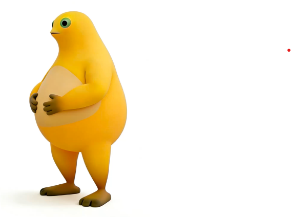

# 奶蛙 · 桌面悬浮窗 AI 助手

一只悬浮在桌面上的黄色小青蛙（Electron 无框透明窗口）：待机时眼睛跟随鼠标、随机眨眼；单击展开对话面板；拖动会奔跑、长按会大笑。支持自接 OpenAI 兼容 API（视觉模型可看图）、MCP 工具、本地文件/命令工具（白名单 + 确认制）。



## 特性

- **桌面宠物交互**：眼睛跟随全局鼠标、眨眼、拖动奔跑（GIF）、长按大笑（WebP），全程 60fps
- **对话面板**：SSE 流式输出、可随时停止、图片粘贴/拖放（自动压缩到 2048px）、快捷提问、追问建议、语音输入与朗读（Web Speech API）
- **Agent 能力底座**：
  - function-calling 工具循环（最多 4 轮，单工具失败不中断，错误回传给模型自适应）
  - MCP 服务器管理（stdio 最小 JSON-RPC 客户端）
  - 本地工具：列目录 / 读文件 / 写文件 / 执行 PowerShell（白名单根目录强校验，写与执行必须逐次确认）
  - **模型路由**：Chat / Code / Vision 三种模式可分别绑定不同 API
  - **私有人设**：自定义 system prompt，配合内置 Skill 指令包
  - **上下文管理**：超长对话自动摘要压缩（约 3000 字触发）+ 硬截断双封顶
- **隐私优先**：不内置模型、无遥测；API Key 用系统级加密存储（Windows DPAPI / Electron safeStorage）；对话历史仅存本机且图片不落盘

## 快速开始

```bash
# 方式一：双击 启动奶蛙.bat（国内镜像自动装依赖）
# 方式二：
npm install
npm start
```

首次使用：点击面板头部 ⚙ 打开「能力配置」→ 填入你的 OpenAI 兼容 API（Base URL / Model / Key）。

## 项目结构

```
ai-vision-app/
├── main.js        # Electron 主进程：窗口/拖拽/API 代理/能力存储/MCP/本地工具/加密
├── preload.js     # contextBridge 白名单 IPC 桥
├── frog.html      # 窗口结构 + 样式（含 CSP）
├── frog.js        # 渲染层逻辑：素材管线/眼睛/动作/对话/设置
├── assets/        # 奶蛙素材（专有，见 LICENSE 附注）
└── tools/
    └── cut_naiwa.py  # 动作 GIF 抠图管线（Python + Pillow + numpy + scipy）
```

## 自检 / 诊断参数

| 参数 | 作用 |
| --- | --- |
| `--shot` | 截取球态与面板态两张图后退出（验证渲染管线） |
| `--shot-run` | 触发奔跑动作每秒截图 4 次（验证动作态窗口尺寸） |
| `--shot-drag` | 静止光标跑拖拽定时器采样 bounds（验证拖动尺寸不漂移） |

## 隐私与数据说明

| 数据 | 位置 | 说明 |
| --- | --- | --- |
| API / MCP / Skill / 人设 / 路由配置 | `%APPDATA%/naiwa-floating/naiwa-capabilities.json` | API Key 经 safeStorage（DPAPI）加密后存储 |
| 对话历史 | `%APPDATA%/naiwa-floating/naiwa-history.json` | 仅文字与摘要，图片不写入磁盘，20 条 / 2MB 上限 |
| 模型请求 | 仅发往你自己配置的 API 地址 | 本应用不收集任何数据、无遥测 |

安全机制：渲染进程 `contextIsolation` + 沙箱、无 `nodeIntegration`、CSP 限制资源加载；本地工具与 MCP 仅运行用户显式配置的内容，写文件 / 执行命令在渲染层逐次弹卡确认。

**免责声明**：本地工具可执行 PowerShell 命令、MCP 可运行任意子进程，请只添加可信来源；使用大模型 API 请遵守对应服务商条款与当地法律法规。

## 许可证

代码以 [MIT](LICENSE) 发布；`assets/` 下的奶蛙素材为专有设计素材，不在 MIT 范围内，二次分发需获得授权。
